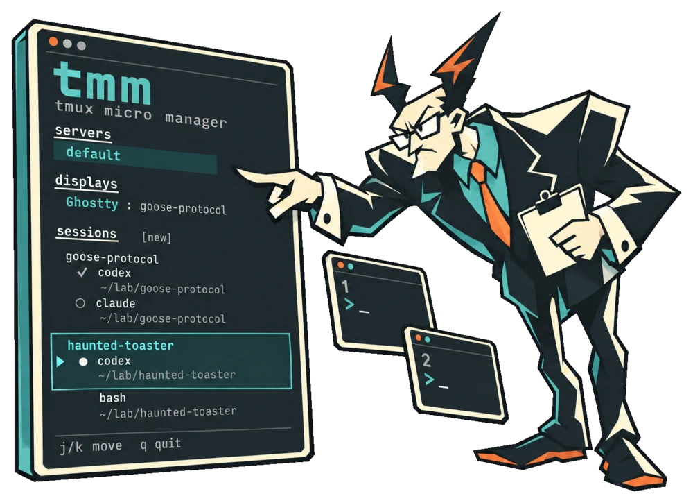

# tmm : tmux micro manager

<p align="center">
  
</p>

A skinny libvaxis sidebar for ordinary tmux sessions. Run it beside your workspace terminal. One scrolling list contains servers, displays, and sessions with every pane and its current directory.

## Build and run

Requires Zig 0.16.0 and tmux. Zig fetches [libtmux](https://github.com/awesomo4000/libtmux) and libvaxis from public repositories, with revisions and content hashes pinned in `build.zig.zon`. Tested with tmux 3.7c and libtmux revision `c63d5aa24d95c8bf757f8ad0b79f81da98275dbf`. No sibling checkout or JavaScript runtime is needed.

The integration suite also passes on Ubuntu 24.04 under WSL with tmux 3.4. Linux x86-64 and ARM64 builds do not require libc. On older tmux versions without centered messages, display identification appears in the status line for five seconds. See [portability-report.md](portability-report.md) for build results and the remaining native Windows blockers.

```sh
zig build
./zig-out/bin/tmm
```

The default launch lists the default server and discovers other running sockets in `$TMUX_TMPDIR/tmux-UID`, or `/tmp/tmux-UID`. Discovery happens at startup. Custom socket paths can be added explicitly:

```sh
./zig-out/bin/tmm -L work --server experiments
./zig-out/bin/tmm -S /tmp/work.sock --server-path /tmp/other.sock
```

`-L` or `-S` selects the initial server and disables automatic discovery, useful for isolated setups. Repeat `--server` or `--server-path` to add entries. Clicking a server clears the previous display target before loading its displays and sessions.

## Navigation

The name at the top is drawn in block letters in the aurora field, with `tmux` over `µmanager` to its right when there is room, the `t` above the `µ`, centred on the banner's height and a row low when that cannot be exact. Each launch picks the letters at random from `quadrant`, `slant`, `chunky`, `block`, `heavy`, `round`, `light`, `double`, `pipes` and `ascii`; `TMM_BANNER=<name>` asks for one. `plain`, the one-line title, is what a window too narrow for the banner gets, and is never picked at random.

A bar in the left gutter marks a session, the way a card's edge does, from its first pane through the blank row after its last, unbroken, leaving the session's name clear, with a half circle growing out of it at a pane's own row. The half circle is the Powerline rounded cap (U+E0B4), which Ghostty and other terminals that draw Powerline shapes themselves show in any font; elsewhere it needs a Nerd Font or similar, and shows as a missing-glyph box without one. The selected session keeps a bright green-cyan bar, its half circle marking the current pane, and sits on a dark blue-teal card the height of its bar, from its name through the blank row after it, fading toward the terminal's background along a cubic curve that holds the colour through most of the row and drops late, to within a step or two of the background at the right edge. tmm asks the terminal for that background at start, and assumes a near black until it answers. The pointer's session gets the same bar, much dimmer, and no card. The keyboard cursor uses the same bar. Click selects. The bar goes when the sidebar loses focus. A pane is not told when the pointer merely leaves it, so moving off without clicking elsewhere leaves the bar on the last row. Wheel scrolling moves the list without activating anything. `j`/`k` or arrows move among actionable rows; Enter activates. Drag a session by its name to put it somewhere else in the list, or press `J`/`K` (Shift-arrows too) to move the session under the cursor down or up; Escape during a drag puts it back. The order lasts as long as tmm runs, and a new session goes to the bottom. `q` or Ctrl-C exits.

Click the `▼` before a session name, or press space on it, to fold the session to that one row; `▶` opens it again. A folded session's name turns green when an agent in it shows a check, so a finished turn is not hidden by the fold. Folds last until tmm exits.

1. Pick a server.
2. Pick the display you want to control. Each display row shows `terminal app : session name`, for example `Ghostty : tmm coding`. Parent-process tracing finds the terminal app; matching names get a tty suffix for disambiguation, and unknown owners fall back to the tty. SSH connections are labeled SSH because the remote terminal app is not visible.
3. Click a pane to show its exact session, window, and pane. To switch a session without choosing a pane, highlight its name and press Enter.

Click a session name to rename it inline. The first text you type replaces the existing name. Enter saves, Escape cancels, and arrows, Backspace, and Ctrl-U edit the field. Renaming uses the stable session ID and does not switch displays. A duplicate or invalid name leaves the editor open for correction.

`--client` can preselect an attached tty at startup. `--label main-workspace` gives the selected display an invocation-local friendly label. Internal IDs and PIDs are not shown in the sidebar.

Click the `✶` at the end of the selected display, or press `b`, to identify it. Hovering a display and pressing `b` identifies that row instead. The chosen terminal shows a text marker steadily for five seconds; other terminals are unaffected. Terminal output continues updating and key presses do not dismiss the label early.

The current pane is read from `list-clients`, which expands its formats per client. `display-message -c <client>` looks like the way to ask where one client is, but `-c` only selects the client for client-specific formats: the target the formats expand against is the server's current pane, so it answers the same for every client and does not move when a client navigates.

Accents take their colour from a four-corner field (`src/aurora.zig`; every colour tmm draws in is named in `src/palette.zig`, first by what it looks like and then by its job): pink to violet along the top, purple to teal along the bottom, stretched over the list as drawn rather than the whole window. The title and headings take it as is, session names faded, and whatever is current lifted toward white. Pane directories take the faded field too. Server and display names are green, so they stand apart from the pink headings. They are indented like panes, and the selected server and display carry a bright `➤` on the left in place of a bar; the one under the pointer shows it dimmed. Status colours are left alone, so a symbol's colour still means its state. A `▸` at the left edge marks the selected display’s current pane; hover does not move that marker. Click `[new]` beside the sessions heading to enter a name, then Enter to create or Escape to cancel. Creation uses the selected display’s current pane directory, names the session and first window, and switches that display into the new session. Other displays stay where they are. Select a display before creating a session. When only one display is attached and none has been chosen, at launch or when the first one attaches, it is selected for you; a chosen display that detaches stays chosen, so the next command reports it gone instead of acting on another. Click a pane to focus it on the selected display. The current pane marker follows native tmux navigation too. A session's directory follows its name, dimmed, with the home directory abbreviated to `~`: the directory most of its panes are in, since the panes of a session usually share one. A pane shows its own directory only when it is somewhere else. Both follow changes to the panes' working directories. Session names are drawn from the blue and teal end of the field so they stand apart from the directories. Process names have a flat colour each, never the gradient: Claude a muted orange, Codex a soft steel blue, other agents their own, and everything else a soft slate. A pane's status symbol carries the state colour; an idle agent's name stays in plain text so a row of idle agents is still readable.

## Agents

Every pane appears under its session. Ordinary panes show their current command; agent panes show their agent name and status indicator. Codex and Claude status is inferred from known controls near the live bottom of the pane screen and from recognized terminal-title signals. Claude activity lines are recognized even when they omit the interrupt hint. The detector adapts selected rules from [Herdr](https://github.com/herdrdev/herdr/tree/b9ce96869e89937278d673d70ae4c135dd318469/src/detect/manifests); provenance and its Apache license are recorded in `THIRD_PARTY_NOTICES.md`.

| Symbol | Meaning |
| --- | --- |
| `●` | Working |
| `!` | Waiting for approval/input |
| `✓` | Completion awaiting acknowledgement |
| `○` | Idle, no outstanding completion |
| `?` | Present, status unknown |

Known working-to-idle transitions require two consecutive idle samples before producing a completion. A first observation of an already-idle process does not prove a completed turn. Explicit `@agent_state=done:<receipt>` can establish a completion immediately. A checkmark remains until clicking that agent successfully navigates to its pane. Acknowledgement applies to the exact receipt and process identity shown when clicked, so an older click cannot clear a newer completion. Outstanding completions remain visible when the pane starts another turn.

The controller also reads explicit `@agent_hint`, `@agent_state`, `@agent_session_id`, and `@agent_status_text`. Nonempty explicit state overrides screen classification. Without a hint it recognizes executable names for Codex, Claude, Aider, OpenCode, and Gemini through pane process ancestry. Automatic screen classification currently supports Codex and Claude only; other agents can report explicit states.

Agent screens are re-captured when the pane produces output. `%output` on the control stream is exact and per pane, but tmux only sends it for the session that stream is attached to, so `window_activity` covers every other session. It is reported for every window whatever any client is looking at, and rides along with the pane listing at no extra query.

Screen detection is heuristic, not an agent protocol. Quiet output alone is never a completion. Unsupported, changed, or unreadable screens remain unknown. Transitions entirely between polls can be missed. Explicit metadata can outlive its writer. Receipt tracking is local to the current controller worker and resets on restart or server switch; it is not yet durable. Automatic acknowledgement from GUI focus is not implemented. `--dump` includes `status_source` and `status_rule` for inspection, but its one-shot collection does not include the running controller's unread history.

Pane navigation validates the pane's membership in the requested session and window before switching. tmux active windows and panes have ordinary shared semantics: other clients viewing the same session/window can observe those selections. Only the chosen client's attached session is switched.

### Reported status

A program can say what it is doing instead of having its screen read: OSC 7501, the [Program Status Protocol](https://www.superlogical.com/rex/docs/build/program-status). tmm reads tmux over control mode and never sees a pane's own bytes, so the record reaches it out of band, as the `@tmm_status` pane option, which tmm reads for every pane on the server in the `list-panes -a` query it already makes. The pane option is needed rather than merely convenient: a control client is told about output only in the one session it is attached to, and an OSC 7501 written to a pane is consumed by tmux, which does not implement it, so it never reaches the text `capture-pane` renders either. The payload is the one the escape sequence carries, parsed by `src/reported.zig`.

The row shows the reported indicator instead of the inferred one, with the percentage for a `working` report that carries progress and the reason for a `blocked` one: `● sh 40%`, `! sh (permission)`, `✗ sh`. `error` has no screen-detectable equivalent at all. The unread `✓` is not added to a reported state, because that mark exists for an inferred completion that may be stale and a report is current by construction.

A record ends when the specification says it does. `working` and `blocked` end when the program that wrote them exits or the next shell prompt starts, `idle` with them, and `done` and `error` outlive both, since those are the two a person has not looked at yet. tmm has no OSC 133 prompt marks, because it never sees a pane's bytes, so it reads the same moment off the process table: a pane whose own shell runs nothing is at its prompt. That is structural rather than by the foreground's name, because a reporter running as `sh build.sh` has a shell's name and is alive, as a child of the pane's shell. A pane whose own process is the program (`tmux new-window claude`) is never at a prompt, so its record lasts as long as the pane. Without this an agent killed by `kill -9`, which sends no clear, read as working forever; `tests/reported_lifetime.py` kills one that way.

The parser follows revision 0.4 where it is specific: a report that breaks a limit, has an `id` outside the grammar, or carries a `title` or `msg` that is not base64 of control-free UTF-8 is discarded whole rather than drawn without the bad part; a malformed pair is skipped and the rest applies; `kind` means something only with `blocked` and `progress` only with `working` or `blocked`. A title longer than the row is cut on a character boundary.

`contrib/agent-status/` emits it: a generic reporter plus a Claude Code hook mapping, opt-in and installed by nothing. The reporter also writes the escape sequence to the pane's tty, which is the protocol itself and costs nothing; a terminal that reads OSC 7501 sees it when the agent runs outside tmux. `tests/agent_hooks_sidebar.py` runs the real hook, detached as Claude Code runs it, across two sessions, and `tests/claude_hook.py` checks the record each event leaves, with payloads shaped as Claude Code sends them.

None of this replaces the screen detector, and it is not meant to. The detector needs no cooperation from anything -- no hooks, no config, no agent support -- which is why it stays the default and keeps deciding every pane that reports nothing. What it cannot be is certain, and that is the whole difference: a report is believed where one exists, and where none does nothing changes.

## Inspection and tests

```sh
./zig-out/bin/tmm --help
./zig-out/bin/tmm -L work --dump
zig build test
python3 tests/integration.py
mise run test          # the suite
mise run clean-tests   # remove what a killed test run left in /tmp
```

The suite cleans up before it starts. The suites create sockets and directories under `/tmp` with `tempfile.TemporaryDirectory`, which cleans up when a test exits normally and not when one is killed by a timeout, so iterating on a failing test accumulates tmux servers; 47 directories had built up across sessions before this was noticed, and an orphaned server from a previous day once made a clean build look like a regression.

`--dump` emits a read-only JSON snapshot without opening the UI. `mise run test` builds, runs the unit tests, then runs the end-to-end tests side by side through `tests/run.py`, in about 15 seconds. They wait on conditions rather than fixed sleeps, so a slow machine takes longer instead of failing. Tests use unique sockets and disposable files under `/tmp`, never the default server. Every harness finds what it runs rather than naming it: the binary from the file's own location, `tmux` from `PATH`, so a checkout runs wherever it is cloned and against whichever tmux is installed. `tests/screen.py` is shared rather than copied, because a constant copied into a dozen files is a constant that only gets changed in one of them. They cover shell and agent pane navigation, client isolation, sidebar mouse input, blink, unusual names and paths, resizing, disconnection, switching servers, failures, and exit.

`tests/reconcile_stress.py` churns panes with no settle between operations, which is what it takes to hit the window the gentle oracle almost always misses: the one divergence that prompted it took six suite runs to appear and never reproduced in forty isolated ones, while the stress version diverged in two of three runs against the code without the guard and none of five with it. The race was in the check rather than the model. The collector drains events, applies them, runs a full query, then compares; a pane created during that query is in the query and not in the model, and the model is not dirty, because the event saying so is still in the queue. `State.isDirty` answers whether the model knows it is stale, which it cannot when the news has not been delivered, so the collector now also notes a counter of queued notifications before the query and skips the comparison if anything arrived while it ran.

## Implementation and remaining work

`src/sidebar.zig` builds sidebar rows and discovers conventional server sockets. `src/main.zig` owns rendering and interaction. `src/backend.zig` reads tmux on a worker -- a control-mode client for events, so tmm learns of a change as it happens rather than by polling processes -- and handles navigation requests. `src/cmstream.zig` and `src/control.zig` are that control-mode transport and its parser; `src/state.zig` and `src/reconcile.zig` keep the incremental model and check it against full queries. `src/model.zig` handles length-prefixed records, client identity, and agent detection, `src/status.zig` the screen-status detector, and `src/reported.zig` the reported status.

All requests stay within the selected server. Display identity includes tty/name, PID, and creation timestamp. Disconnects require explicit selection again. Failed refreshes retain the previous snapshot and display the tmux diagnostic.

Reads span several commands, and client revalidation is separate from mutations, so topology can change between them. libtmux does not yet expose command deadlines. Persistent display registration, focus hooks, durable completion storage, broader agent support, and event-driven refreshes remain follow-up work. No hooks or layout changes are installed.

## The compositor, and where it went

tmm used to have two more modes. `--shell` drew a libghostty-vt terminal beside the sidebar, and `--panes` composited a tmux session's panes itself -- one libghostty-vt terminal per pane, fed from `%output` before tmux's own parser runs -- which is what let kitty graphics through a stock tmux. It worked, and it became a reimplementation of the tmux client one piece at a time: the prefix, repeat bindings, focus, session switching, sizing. So tmm went back to being a controller, and the terminal work moved outward, to a compositor that owns its own pseudoterminals and runs tmux in one of its windows.

The last commit with both modes is tagged `compositor-final`. It is kept as a stable reference rather than history to dig through, because the libghostty-vt integration, the PNG decoding, the kitty placement and their tests are being adapted elsewhere: `git show compositor-final:src/surface.zig`, and its README and `handoff.md` record what was measured and why.

## TODO

- [ ] Find the exit-time leak report that will not reproduce. It was seen twice on a real server, around 27 `DebugAllocator` reports on quit, and twenty scenarios built to provoke it all exited clean -- including the server dying first, which was the suspected trigger. The reported line numbers interleave frames that cannot belong to one call, so they are not the real sites. What was tried and ruled out is in `git show compositor-final:handoff.md`, section 9.
- [ ] Report status from the agents other than Claude Code -- Codex, omp, pi. `contrib/agent-status/` has the transport and the Claude Code mapping, and nothing in the emitter is agent specific, so each of the others needs its own mapping from its own lifecycle events. Check two things first for any of them, because both were measured false for the obvious route: whether its hook has a controlling terminal, and whether it passes the pane environment through. See that directory's README.

## License

This project is licensed under the [Mozilla Public License 2.0](LICENSE). Third-party attribution and license information are in [THIRD_PARTY_NOTICES.md](THIRD_PARTY_NOTICES.md).
